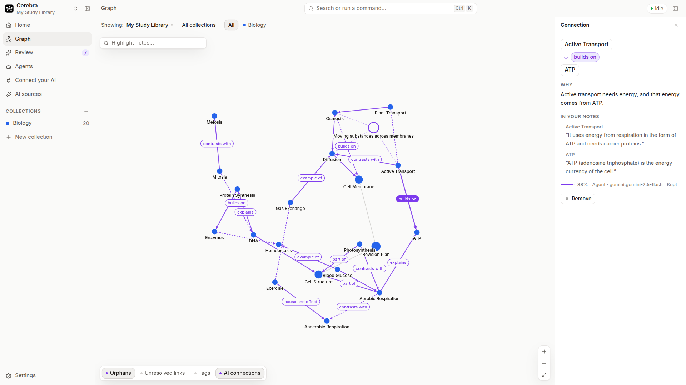
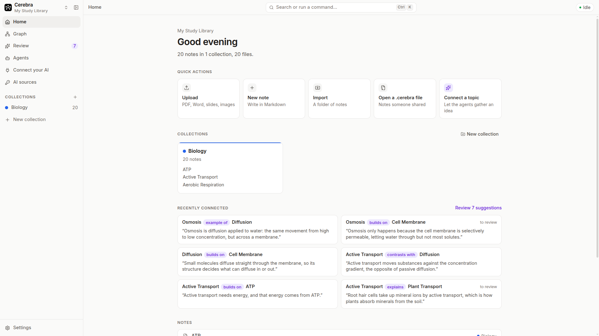
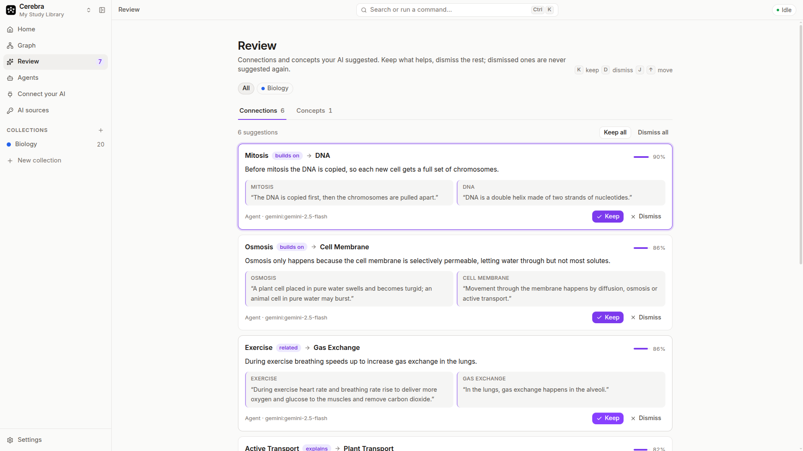
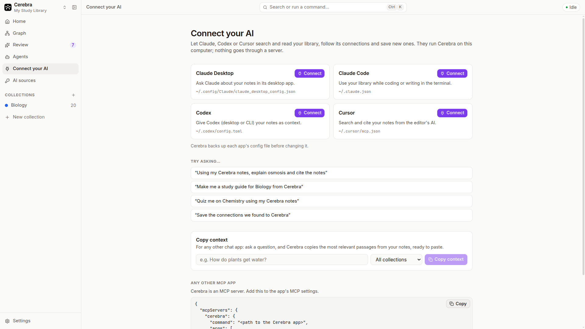
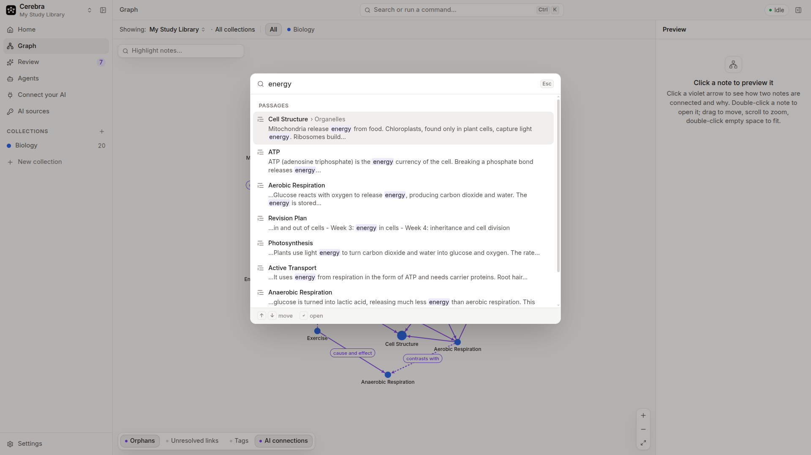

<p align="center">
  
</p>

<h1 align="center">Cerebra</h1>

<p align="center">
  <b>Turn hundreds of notes, PDFs and slides into a library your AI can actually use.</b><br>
  Free, open source and private. Everything stays on your computer.
</p>

<p align="center">
  <a href="https://github.com/Kawaii-Inosuke/Cerebra/releases/latest"></a>
  <a href="LICENSE"></a>
  <a href="https://github.com/Kawaii-Inosuke/Cerebra/releases"></a>
  <a href="https://github.com/Kawaii-Inosuke/Cerebra/actions/workflows/ci.yml"></a>
  
</p>

<p align="center">
  <a href="https://glama.ai/mcp/servers/Kawaii-Inosuke/Cerebra"></a>
</p>

<p align="center">
  <a href="https://github.com/Kawaii-Inosuke/Cerebra/releases/latest"><b>Download</b></a> ·
  <a href="#how-it-works">How it works</a> ·
  <a href="#connect-claude-codex-or-cursor">Connect your AI</a> ·
  <a href="docs/11-ROADMAP.md">Roadmap</a>
</p>

<p align="center">
  
</p>

## Why Cerebra?

If you have a lot of material, AI chatbots quickly hit a wall:

- Your files are **too big to upload**, or the **context limit runs out** halfway through.
- You **paste the same documents again** in every new chat.
- Answers **drift away from what your files actually say**, with nothing to check them against.

Cerebra keeps all of it in one local library, finds how your ideas connect, and gives your AI **only the
passages that matter** for each question, so answers stay short, cheap and backed by your own sources.

## What it does

- **One library for everything.** Notes, PDFs, Word files, PowerPoint slides, images and scanned pages
  (read with on-device OCR). A library is an ordinary folder; existing folders of Markdown notes work as
  they are.
- **Finds the connections that matter.** AI agents read your material and save only useful links
  between documents, labelled with how they relate (*explains*, *builds on*, *contrasts with*…), each
  with a reason and a quote from both sides. You keep or reject every one; your files are never changed.
- **Search by meaning.** Find the right passage across hundreds of documents, even without the exact words.
- **Works with your AI app.** Claude Desktop, Claude Code, Codex and Cursor can search your library,
  answer with citations to your notes, and save new connections themselves.
- **Bring any AI, including free ones.** Free keys from Gemini or Groq, paid keys from OpenAI,
  Anthropic and others, or a model on your own computer (Ollama, LM Studio). When one key hits its
  limit, the next takes over.
- **Share a topic as a file.** Export `Biology.cerebra`; a friend opens it and gets the same notes and
  connections. Optional password.
- **Private by design.** No account, no cloud, no tracking. Text only goes to the AI service you choose,
  and you can keep sensitive collections strictly local.

## Screenshots

| | |
|---|---|
|  |  |
| **Home:** your library and the latest connections | **Review:** keep or dismiss every suggestion |
|  |  |
| **Connect your AI** in one click, or copy context | **Search** across everything in seconds |

## Install

| System | Download |
|---|---|
| **Windows 10/11** | `Cerebra_…_x64-setup.exe` (or `.msi`) from the [latest release](https://github.com/Kawaii-Inosuke/Cerebra/releases/latest). Microsoft Store listing coming soon. |
| **macOS** (Apple Silicon: M1 and newer) | `Cerebra_…_aarch64.dmg` from the [latest release](https://github.com/Kawaii-Inosuke/Cerebra/releases/latest) |
| **Linux** (Ubuntu 24.04 or newer, or similar) | `.AppImage` (any distribution), `.deb` (Ubuntu, Debian, Mint) or `.rpm` (Fedora, openSUSE) from the [latest release](https://github.com/Kawaii-Inosuke/Cerebra/releases/latest) |

**Updates:** from version 0.1.2, Cerebra tells you when a new version is out and installs it for you
(**Update now**, **Later** or **Next time I open Cerebra**). You can turn this off in Settings.

### First launch

The installers on GitHub aren't code-signed yet (signing certificates cost money every year, and Apple has
no free option), so your system warns you once:

| System | What you'll see | What to do |
|---|---|---|
| **Windows** | "Windows protected your PC" | Click **More info** → **Run anyway** (only once) |
| **macOS** | "Cerebra can't be opened… Apple could not verify…" | Click **Done**, open **System Settings → Privacy & Security**, find *Cerebra was blocked*, click **Open Anyway** |
| **macOS** (terminal) | Same | `xattr -dr com.apple.quarantine /Applications/Cerebra.app` |
| **Linux** | AppImage won't start | `chmod +x Cerebra_*.AppImage` (or Properties → *Allow executing*) |

You can check any download against `SHA256SUMS.txt` on the release page, or build Cerebra yourself (below).

**Code signing:** the Microsoft Store version is signed by Microsoft and shows no warning. We plan to sign
GitHub releases through the [SignPath Foundation](https://signpath.org) (free code signing for open-source
projects, provided by [SignPath.io](https://about.signpath.io)) once the project is established enough for
their program. See the [code signing policy](CODE_SIGNING_POLICY.md).

## How it works

1. **Add material.** Create a library (any folder) and drop in notes, PDFs, Word, PowerPoint or photos of
   pages. Scans are read with on-device OCR.
2. **Add an AI.** Paste one or more API keys (Gemini, Groq, OpenRouter and Mistral have free tiers;
   OpenAI, Anthropic, DeepSeek or any OpenAI-compatible service also work) or use a model on your computer
   (Ollama, LM Studio). Put them in order; when one hits its limit, the next takes over.
3. **Let it connect.** Cerebra's agents (built on [Strands Agents](https://strandsagents.com)) read new
   material, find related passages in your other notes, and keep only connections that are specific,
   useful and backed by exact quotes from both notes. You review them, or let them through.
4. **Explore.** See it all as a graph, follow the arrows, and search by meaning.
5. **Ask your AI app.** Connect Claude, Codex or Cursor (below) and ask questions that cite your notes.

## Connect Claude, Codex or Cursor

Open **Connect your AI** in Cerebra and click **Connect** next to Claude Desktop, Claude Code, Codex or
Cursor. Then try:

- *"Using my Cerebra notes, explain osmosis and cite the notes."*
- *"Make me a study guide for Biology from Cerebra."*
- *"Read my notes on respiration and save the connections that are missing."*

Using another chat app? **Copy context** puts the most relevant passages for a question on your clipboard,
ready to paste. Any app that supports MCP can use Cerebra too (setup text is in the app).

## Privacy

Cerebra collects nothing: no account, no analytics, no server. Your notes and keys stay on your computer,
and text only goes to the AI services you set up yourself. It checks GitHub (or the Microsoft Store) for new
versions, sending nothing about you, and you can turn that off. Details: [privacy policy](docs/PRIVACY.md).

## Build from source

You need [Rust](https://rustup.rs) (stable), [Node.js](https://nodejs.org) 20+, and
[uv](https://docs.astral.sh/uv/) for the agents. On Linux also:
`sudo apt install libwebkit2gtk-4.1-dev build-essential libxdo-dev libssl-dev libayatana-appindicator3-dev librsvg2-dev`.

```bash
git clone https://github.com/Kawaii-Inosuke/Cerebra.git && cd Cerebra
npm install
node scripts/fetch-models.mjs          # local models (OCR, search by meaning) into ./models
node scripts/build-sidecar.mjs         # the agents program (Python + Strands) as one binary
npm run tauri dev                      # run the app
npm run tauri build                    # make installers in target/release/bundle
```

Try it on the sample library: `fixtures/libraries/biology-small` (20 short biology notes).

The engine also works from the command line (`cargo run -p cerebra-cli -- <library> --help`):
`info`, `search`, `context`, `upload`, `import`, `export`, `import-share`, `mcp`, and `serve`
(a browser preview of the app at http://127.0.0.1:1430 after `npm run build`).

## Contributing

Ideas, bug reports and pull requests are welcome. Start with [CONTRIBUTING.md](CONTRIBUTING.md), browse the
[open issues](https://github.com/Kawaii-Inosuke/Cerebra/issues), or report a problem from inside the app
(**About → Report a problem**). Design docs are in [`docs/`](docs/README.md), and what's planned next is
in the [roadmap](docs/11-ROADMAP.md).

**If Cerebra helps you, a ⭐ on GitHub helps other people find it.**

## License

[MIT](LICENSE). Bundled models and dependencies keep their own licences; see
[THIRD-PARTY-NOTICES.md](THIRD-PARTY-NOTICES.md).
